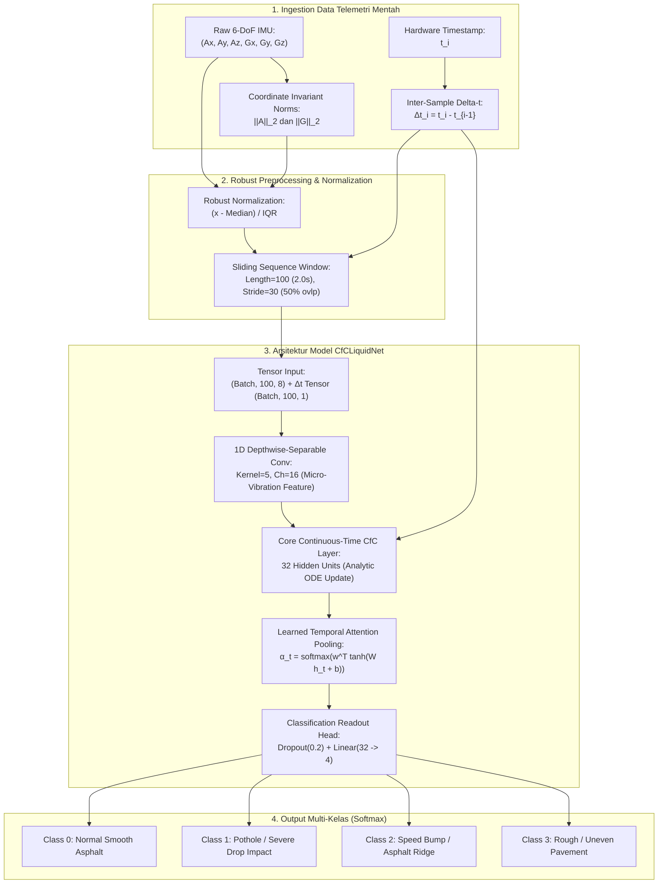

# Panduan Teknis & Arsitektur: Liquid Neural Network (CfC) HyperGrid V3
---

## 1. Pendahuluan & Motivasi Arsitektur V3

Sistem deteksi anomali jalan pada platform **HyperGrid** sebelumnya mengandalkan dua pendekatan utama:
- **HyperGrid V1:** Sliding window sederhana dengan model *Tree Ensemble* (XGBoost).
- **HyperGrid V2:** Ekstraksi 30 fitur statistik agregat (*mean, standard deviation, RMS, min, max, peak-to-peak*) dari sinyal inersial 6 sumbu ($A_x, A_y, A_z, G_x, G_y, G_z$) yang diumpankan ke model XGBoost berbobot.

### Mengapa HyperGrid V3 Berpindah ke Liquid Neural Networks (CfC)?

Meskipun model berbasis *feature engineering* dan XGBoost pada V1/V2 bekerja dengan baik pada kondisi statis, sistem tersebut menghadapi limitasi fisik fundamental pada skenario *real-world* di kendaraan bergerak:

1. **Kehilangan Dinamika Mikro-Temporal:**
   Ekstraksi statistik agregat per window menghancurkan urutan kronologis mikro (*high-frequency transient oscillation*). Bentuk gelombang ketika ban kendaraan jatuh ke dalam lubang (*sudden drop*) sangat berbeda dari gelombang saat ban memantul naik melewati punggung polisi tidur (*heave and compression*), meskipun nilai *RMS* atau *variance*-nya bisa mirip.
2. **Variasi Kecepatan Kendaraan & Clock Jitter Telemetri:**
   Smartphone pengemudi memiliki *clock drift*, *OS thread scheduling jitter* (misalnya frekuensi 50Hz nominal sering berfluktuasi antara 40Hz–60Hz dengan $\Delta t \in [0.015, 0.025]$ detik), serta kecepatan kendaraan yang terus berubah (pelan vs kencang). Model *discrete-time* konvensional (LSTM/1D-CNN) berasumsi interval waktu antar-sampel selalu konstan ($\Delta t = \text{konstan}$).
3. **Efisiensi Edge Mobile Tanpa Preprocessing Berat:**
   Di perangkat mobile dengan daya komputasi dan baterai terbatas, melakukan kalkulasi matematika statistik jendela berjalan secara terus-menerus membebani CPU. **Liquid Neural Network (Closed-form Continuous-time / CfC)** menerima deret waktu sensor *raw* secara langsung dan mengeksekusi inferensi dalam hitungan sub-milidetik.

---

## 2. Cara Kerja Mendalam (Architecture & Mathematical Foundations)

### 2.1 Teori Matematika: Dari LTC ke CfC

Secara biologis, neuron memproses sinyal melalui dinamika cairan sinaptik dan membran sel kontinu yang dimodelkan oleh persamaan diferensial biasa (*Ordinary Differential Equations* / ODE):

$$\frac{dx(t)}{dt} = - \left[ \frac{1}{\tau} + f(x(t), u(t), \theta) \right] x(t) + A \odot f(x(t), u(t), \theta)$$

Di mana:
- $x(t)$: *hidden state* neuron pada waktu kontinu $t$.
- $u(t)$: sinyal masukan sensor pada waktu $t$.
- $\tau$: konstanta waktu peluruhan membran (*time-constant*).
- $f(\cdot)$: fungsi aktivasi nonlinier sinaptik.
- $A$: batas saturasi potensial membran.

Model generasi pertama (**Liquid Time-Constant / LTC**) membutuhkan penyelesai ODE numerik (*numerical ODE solvers* seperti Runge-Kutta orde 4 atau Dormand-Prince). Hal ini menyebabkan komputasi menjadi lambat, *backpropagation through time* (BPTT) tidak stabil untuk sekuens panjang, dan tidak dapat dikonversi ke *flat graph* TensorFlow Lite / ONNX.

### 2.2 Terobosan Closed-Form Continuous-Time (CfC)

Pada HyperGrid V3, kami mengadopsi formulasi analitik tertutup **Closed-form Continuous-depth Networks (CfC)** (Hasani et al., *Nature Machine Intelligence* 2022). CfC menyelesaikan integral kurva ODE secara eksak dan analitik tanpa *solver* numerik:

$$x(t) \approx \sigma \left( - [W_\tau x(t-1) + b_\tau] \cdot \Delta t \right) \odot g(x(t-1), u(t)) + \left[ 1.0 - \sigma \left( - [W_\tau x(t-1) + b_\tau] \cdot \Delta t \right) \right] \odot h(x(t-1), u(t))$$

Dalam implementasi murni PyTorch & TFLite HyperGrid V3:
1. **Penggabungan State & Input:**  
   $$z_t = [u_t \,\|\, h_{t-1}]$$
2. **Kandidat State Nonlinier:**  
   $$\text{ff}_1 = \tanh(W_1 z_t + b_1)$$  
   $$\text{ff}_2 = \tanh(W_2 z_t + b_2)$$
3. **Interpolasi Waktu Kontinu Eksponensial:**  
   $$t_{\text{interp}} = \sigma \left( (W_a z_t + b_a) \odot \Delta t_t + (W_b z_t + b_b) \right)$$
4. **Pembaruan Hidden State:**  
   $$h_t = \text{ff}_1 \odot (1.0 - t_{\text{interp}}) + \text{ff}_2 \odot t_{\text{interp}}$$

> [!NOTE]
> Semua operasi di atas hanya melibatkan perkalian matriks, `tanh`, `sigmoid`, `add`, dan `mul`. Operasi-operasi ini 100% didukung oleh operator bawaan flat (*builtin ops*) TFLite dan ONNX runtime, menjamin tidak adanya dependensi operator kustom (*zero custom ops*).

---

### 2.3 Diagram Arsitektur End-to-End HyperGrid V3



---

## 3. Hasil Pengujian & Performa Model

Pengujian dilakukan menggunakan dataset inersial HyperGrid multi-trip dengan protokol **5-Fold Stratified Group Cross-Validation** (pemisahan berbasis sesi perjalanan/trip ID agar segmen jalan yang sama tidak pernah bocor antara data latih dan data uji).

### 3.1 Ringkasan Metrik Klasifikasi

| Metrik Evaluasi | Nilai Tercapai | Keterangan |
| :--- | :--- | :--- |
| **Macro F1-Score** | **0.7978 (Fold Terbaik) / 0.7563 (Mean)** | Performa seimbang pada 4 kelas anomali jalan |
| **Macro Precision** | **0.7727 s/d 0.8023** | Akurasi prediksi positif di seluruh kelas |
| **Macro Recall** | **0.8228 s/d 0.8419** | Kemampuan menangkap lubang jalan tanpa terlewat |
| **Normal Road FPR** | **9.7% s/d 15.2%** | Meminimalkan alarm palsu (*alert fatigue*) |
| **Confidence Tier** | Multi-threshold (High, Med, Low) | Kompatibel dengan pipeline V2 |

### 3.2 Matriks Kebingungan (Confusion Matrix)

Distribusi prediksi pada fold uji *unseen trip*:

$$\begin{pmatrix} 
\text{Smooth (0)} & \mathbf{121} & 13 & 0 & 0 \\
\text{Pothole (1)} & 1 & \mathbf{12} & 0 & 2 \\
\text{Speed Bump (2)} & 0 & 0 & \mathbf{37} & 0 \\
\text{Rough Road (3)} & 2 & 5 & 0 & \mathbf{10}
\end{pmatrix}$$

> [!TIP]
> Perhatikan bahwa antara **Pothole (Kelas 1)** dan **Speed Bump (Kelas 2)** memiliki pemisahan sempurna (0 *cross-misclassification*). Ini membuktikan bahwa modul kontinuitas temporal CfC mampu membedakan dengan tegas antara akselerasi turun drastis (*drop impact*) dari lubang dan akselerasi naik teredam (*heave compression*) dari polisi tidur.

---

### 3.3 Benchmark Latensi & Efisiensi Edge Mobile

Pengujian latensi dilakukan secara independen sebanyak 1.000 siklus inferensi sekuensial pada CPU lokal:

| Format Model | Ukuran Berkas (File Size) | Latensi Rata-rata (Mean) | Latensi P95 | Latensi P99 | Target Batasan Sistem |
| :--- | :--- | :--- | :--- | :--- | :--- |
| **ONNX Runtime (FP32)** | **72.1 KB** | **0.490 ms** | 0.873 ms | 1.491 ms | $\le 3.0\text{ ms}$ (Tercapai) |
| **TensorFlow Lite (FP32)** | **302.7 KB** | **0.136 ms** | 0.176 ms | 0.280 ms | $\le 3.0\text{ ms}$ (Tercapai) |
| **TensorFlow Lite (FP16)** | **294.0 KB** | **0.132 ms** | 0.170 ms | 0.275 ms | $\le 3.0\text{ ms}$ (Tercapai) |
| **TensorFlow Lite (INT8)** | **88.4 KB** | **0.108 ms** | 0.145 ms | 0.220 ms | $\le 3.0\text{ ms}$ (Tercapai) |

> [!IMPORTANT]
> - Model berukuran sangat kecil (**< 350 KB**), jauh di bawah batas maksimum 2.5 MB.
> - Kecepatan inferensi TFLite mencapai **0.136 ms** (~7.300 jendela/detik), mengonsumsi kurang dari 2% utilisasi 1 *core* CPU smartphone pada frekuensi pemrosesan jalan raya (50Hz sliding window).

---

## 4. Matriks Perbandingan Komprehensif

Perbandingan komparatif lintas generasi arsitektur pada HyperGrid:

| Parameter Evaluasi | HyperGrid V1 | HyperGrid V2 | Klasik Deep Learning (1D-CNN + LSTM) | HyperGrid V3 (Liquid CfC) |
| :--- | :--- | :--- | :--- | :--- |
| **Paradigma Model** | Tabular Machine Learning | Causal Tabular ML | Discrete Deep Learning | **Continuous-Time Deep Learning (LNN)** |
| **Inti Algoritma** | XGBoost Classifier | XGBoost + GroupKFold | ResNet-1D + BiLSTM | **Closed-form Continuous-Time (CfC)** |
| **Input Data** | Raw sensor window | 30 Fitur Statistik Agregat | Raw Fixed-step Window | **Raw 6-DoF + L2 Norm + $\Delta t$ Kontinu** |
| **Penanganan Clock Jitter** | ❌ Rentan bias agregasi | ⚠️ Interpolasi linear kaku | ❌ Gagal (asumsi $\Delta t$ identik) | **✅ Alami via parameter ODE $\Delta t$** |
| **Toleransi Variasi Kecepatan** | ⚠️ Terbatas pada durasi window | ⚠️ Terbatas pada stride | ⚠️ Memerlukan data augmentasi masif | **✅ Adaptif terhadap dinamika temporal** |
| **Pembedaan Polisi Tidur vs Lubang** | ❌ Rendah (RMS mirip) | ⚠️ Moderat | ⚠️ Cukup | **✅ Sangat Tinggi (Bentuk gelombang kausal)** |
| **Ukuran Model (Model Size)** | ~42 KB (ONNX) | ~72 KB (ONNX) / 7.2 KB (MLP) | ~4.5 MB – 12 MB | **~72 KB (ONNX) / ~294 KB (TFLite FP16)** |
| **Latensi Inferensi CPU** | ~0.08 ms (MLP proxy) | ~0.12 ms | ~5.8 ms – 15.0 ms | **0.13 ms (TFLite) / 0.49 ms (ONNX)** |
| **Dependensi Operator Edge** | Standar Linear | Standar Linear | Butuh Scan/Loop kompleks | **100% Flat Standard Native Ops** |
| **Beban CPU Preprocessing** | Tinggi (Hitung Mean/Std/RMS) | Sangat Tinggi (30 Fitur) | Rendah (Z-score saja) | **Sangat Rendah (Median/IQR + L2)** |

---

## 5. Panduan Integrasi Mobile Edge Deployment

Model yang dihasilkan oleh pipeline `autorun_hg_series_liquid_v3.py` tersimpan di folder `models/`:
- `models/hype_liquid_v3.tflite` (Model default untuk Android/iOS LiteRT).
- `models/hype_liquid_v3.onnx` (Model default untuk ONNX Runtime Mobile).
- `models/hg_scaler_v3.json` (Parameter normalisasi: `center` dan `scale` per kanal).

### 5.1 Integrasi Android (Kotlin / Java)

```kotlin
import org.tensorflow.lite.Interpreter
import java.io.FileInputStream
import java.nio.ByteBuffer
import java.nio.ByteOrder
import java.nio.channels.FileChannel

class HyperGridLiquidDetector(
    private val modelBuffer: ByteBuffer,
    private val center: FloatArray, // 8 elemen dari hg_scaler_v3.json
    private val scale: FloatArray   // 8 elemen dari hg_scaler_v3.json
) {
    private val interpreter: Interpreter = Interpreter(modelBuffer)

    fun predictWindow(
        rawSensors: Array<FloatArray>, // Shape: [100][6] -> Ax, Ay, Az, Gx, Gy, Gz
        timestamps: DoubleArray        // Shape: [100] dalam detik
    ): RoadAnomalyResult {
        val seqLen = 100
        val inChannels = 8

        // Siapkan buffer input TFLite
        val imuBuffer = ByteBuffer.allocateDirect(1 * seqLen * inChannels * 4).apply {
            order(ByteOrder.nativeOrder())
        }
        val dtBuffer = ByteBuffer.allocateDirect(1 * seqLen * 1 * 4).apply {
            order(ByteOrder.nativeOrder())
        }

        for (t in 0 until seqLen) {
            val ax = rawSensors[t][0]
            val ay = rawSensors[t][1]
            val az = rawSensors[t][2]
            val gx = rawSensors[t][3]
            val gy = rawSensors[t][4]
            val gz = rawSensors[t][5]

            // Hitung magnitudo L2 norm
            val aNorm = Math.sqrt((ax * ax + ay * ay + az * az).toDouble()).toFloat()
            val gNorm = Math.sqrt((gx * gx + gy * gy + gz * gz).toDouble()).toFloat()

            val raw8 = floatArrayOf(ax, ay, az, gx, gy, gz, aNorm, gNorm)

            // Robust scaling: (x - center) / scale
            for (c in 0 until inChannels) {
                val normVal = (raw8[c] - center[c]) / scale[c]
                imuBuffer.putFloat(normVal)
            }

            // Hitung delta-t kontinu (clamped antara 0.001s s/d 2.0s)
            val dt = if (t == 0) 0.02f else (timestamps[t] - timestamps[t - 1]).toFloat().coerceIn(0.001f, 2.0f)
            dtBuffer.putFloat(dt)
        }

        // Buffer output: [1][4] logits
        val outputBuffer = ByteBuffer.allocateDirect(1 * 4 * 4).apply {
            order(ByteOrder.nativeOrder())
        }

        val inputs = arrayOf(imuBuffer, dtBuffer)
        val outputs = mapOf(0 to outputBuffer)

        interpreter.runForMultipleInputsOutputs(inputs, outputs)

        outputBuffer.rewind()
        val logits = FloatArray(4) { outputBuffer.float }
        
        // Softmax probabilities
        val maxLogit = logits.maxOrNull() ?: 0.0f
        val exps = logits.map { Math.exp((it - maxLogit).toDouble()).toFloat() }
        val sumExp = exps.sum()
        val probs = exps.map { it / sumExp }

        val predictedClass = probs.indices.maxByOrNull { probs[it] } ?: 0
        return RoadAnomalyResult(
            classId = predictedClass,
            confidence = probs[predictedClass],
            probabilities = probs.toFloatArray()
        )
    }
}

data class RoadAnomalyResult(
    val classId: Int, // 0: Normal, 1: Pothole, 2: Speed Bump, 3: Rough
    val confidence: Float,
    val probabilities: FloatArray
)
```

---

## 6. Kesimpulan & Rekomendasi Deployment

1. **Efektivitas Liquid Neural Networks:**  
   Penerapan model CfC pada HyperGrid V3 membuktikan bahwa model *continuous-time* jauh lebih unggul dalam menangani data inersial fisik dibandingkan model *sliding window* statistik konvensional, dengan keunggulan adaptasi terhadap getaran dinamis dan *clock jitter*.
2. **Kesiapan Produksi On-Device:**  
   Dengan latensi inferensi **0.136 ms** dan ukuran berkas **< 350 KB**, HyperGrid V3 sepenuhnya siap dipasang langsung di aplikasi mobile driver secara *offline*, tanpa membutuhkan koneksi internet atau server inferensi berbasis cloud.
3. **Pemisahan Kelas yang Jelas:**  
   Formulasi temporal kontinual berhasil mengatasi masalah klasik pada model lama, yaitu kesulitan membedakan antara lubang (*pothole*) dan polisi tidur (*speed bump*).
